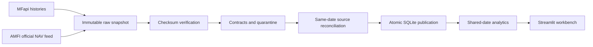

# India Fund Lens

**A research workbench for Indian passive equity funds: comparable performance, drawdown recovery, and visible data trust.**

A fund reviewer needs to know more than which scheme returned the most. Did the schemes have the same observation window? How severe was the worst decline? Has it recovered? Do the historical NAVs agree with the official publisher?

India Fund Lens answers those questions for six explicitly selected direct-growth index plans. It uses **MFapi.in**, a free, keyless Indian mutual-fund API, and **AMFI's official NAV feed** for independent same-date reconciliation. AMFI is an Indian industry association, not a government agency. No global weather or market provider is used.

## Run locally

Python 3.9–3.12 is supported by the pinned direct dependencies; Python 3.11 is recommended. Internet access is needed for installation and live extraction. No keys, Docker, databases to provision, or manual data preparation are required.

```bash
git clone <repository-url>
cd <repository-folder>
python -m venv .venv
# Windows:
.venv\Scripts\activate
# macOS/Linux:
source .venv/bin/activate
pip install -r requirements.txt
python etl.py
streamlit run app.py
```

Use the activation command for your operating system. Replace the repository placeholders with the actual Git URL and folder name. Open the local URL printed by Streamlit, usually http://localhost:8501.

The live run performs seven sequential requests: six full NAV histories and the official AMFI feed. Normally allow roughly one minute; retries and an unavailable upstream can take longer. The dashboard itself reads local data and makes no API requests on reruns.

### Reproducible offline review

A small, real raw snapshot extracted on **10 October 2026 IST** is committed with original responses, request URLs, and SHA-256 checksums. It is a dated review artifact, not current market data.

```bash
python etl.py --replay data/raw/sample
streamlit run app.py
```

Replay needs no network after dependencies are installed. The UI labels replay mode and warns about stale extracts. `python etl.py` switches back to a live refresh. Any saved run folder can be passed to `--replay`.

### Verification

```bash
python -m pytest -q
```

Tests run offline and create temporary databases. They cover calculation examples, source identity, invalid values, future dates, duplicate conflicts, AMFI schema changes, source lag vs. mismatches, HTTP failures, raw-file tampering, atomic publication, deterministic replay, and Streamlit interactions.

On Apple's bundled Python 3.9, urllib3 may warn that its LibreSSL build is unsupported. Live extraction was exercised successfully in this environment, but use Python 3.11 with OpenSSL for a clean installation rather than suppressing the warning.

## Repository structure

```text
README.md
requirements.txt
app.py                      # Streamlit analytical workbench
etl.py                      # Live extraction / offline replay CLI
data/
  raw/
    sample/                 # Real source responses and checksum manifest
    <run-id>/               # Additional immutable live extracts (Git ignored)
  processed/
    fund_lens.sqlite        # Atomically published analytical database (generated)
ai_transcript/              # Reserved deliverable directory
src/
  config.py                 # Declared watchlist and source endpoints
  extract.py                # HTTP retry policy, raw persistence, verified replay
  transform.py              # Data contracts, quarantine and reconciliation
  analytics.py              # Shared-date returns, drawdowns and co-movement
  storage.py                # Atomic SQLite publication and read-only loading
tests/
.streamlit/config.toml
pytest.ini
```

## Product direction

**Audience:** a fund research or portfolio-review analyst examining passive equity implementation and the quality of its supporting data.

**Scope:** HDFC, UTI and Bandhan Nifty 50; ICICI and UTI Nifty Next 50; DSP Nifty 50 Equal Weight. Scheme codes are stable join keys; full current scheme names and categories come from the API. Labels are only presentation aliases. This is a handpicked watchlist, not an investment ranking or exhaustive fund screener.

**Why these sources:** Indian-market specialization, long historical NAV series, no authentication, and a second Indian publisher to expose lag and discrepancies. MFapi supplies the primary JSON API; AMFI supplies an official delimited download endpoint. The AMFI feed is parsed by header names because its column layout has changed.

**Why no predictive model:** NAV histories alone do not support a defensible claim of forecasting future fund performance. Transparent retrospective metrics and explicit data uncertainty better serve the review decision.

## Architecture and data model



| Table | Grain / purpose |
|---|---|
| `funds` | One row per scheme; label, mandate, publisher metadata, history bounds |
| `nav` | One row per scheme code and reported date; positive finite NAV |
| `quality` | One finding per check and affected scheme, including severity and count |
| `quarantine` | Rejected raw date/NAV pairs with reasons |
| `reconciliation` | Per-scheme official NAV, matching historical value, and reconciliation status |
| `run` | Snapshot timestamp, build time, mode, source URLs/hashes, extraction errors |

Dates are source calendar dates. Extraction timestamps are UTC and displayed in Asia/Kolkata. The pipeline keeps full returned histories; the app applies date filters interactively. SQLite is bundled with Python and requires no service.

Each live extraction gets a new run directory. Raw responses are written before parsing, and a manifest records successes and request failures. Replay checks every recorded hash. The declared fund universe must be complete; a missing fund blocks publication rather than silently changing the comparison universe. AMFI is optional: its absence is visible as unverified data and does not erase otherwise usable historical NAVs.

Validated tables are written into a temporary SQLite database. Unique indexes, an orphan check and an integrity check run before a single `os.replace` publishes the database. A failed refresh returns exit code 1 and preserves the previous published data. The app cache keys on the database modification time, so a rerun picks up a successful replacement. Run one ETL writer at a time; scheduling/concurrent-writer coordination is outside scope.

## Dashboard

1. **Performance:** peer-group and fund filters, date range, equal-start-value curves, returns, CAGR, volatility and CSV export.
2. **Drawdown & recovery:** underwater curves and the peak, trough and recovery dates of each worst episode; unfinished recoveries are explicitly ongoing.
3. **Co-movement:** return-correlation matrix. Similar return behavior is not evidence of identical holdings.
4. **Data trust:** source reconciliation, quality findings, quarantined rows and raw lineage.
5. **Methodology:** definitions and limitations available beside the charts.

No “best fund” badge is assigned. Mandates differ; peer-group filtering avoids comparing index exposure as if it were fund-manager skill. The illustrative initial amount scales a NAV curve; it is not an actual investor portfolio or a claim about realized after-tax returns.

## Calculation contracts

All selected funds use the **intersection of reported dates** within the selected range. This aligns both endpoints and return intervals. Dates lost to alignment are disclosed. No NAV is forward-filled, interpolated or synthesized. At least 60 shared dates are required.

| Metric | Definition |
|---|---|
| Period return | `last NAV / first NAV - 1` |
| CAGR | `(last / first) ** (365.25 / elapsed calendar days) - 1`; withheld below 365 days |
| Indexed series | `100 * NAV / first NAV` |
| Drawdown | `NAV / cumulative maximum NAV - 1` |
| Maximum drawdown | Minimum drawdown within the selected observation window |
| Worst-episode duration | Calendar days from the most recent equal peak before the worst trough to first observed recovery, or the final date if ongoing |
| Annualized volatility | Sample standard deviation of eligible shared-date returns × `sqrt(252)` |
| Correlation | Pearson correlation on the same eligible returns; minimum 60 observations |
| Shared-date coverage | Shared date count / union date count within selected scope |

Returns spanning more than four calendar days are excluded from volatility and correlation. This prevents a long outage being treated as one daily return, but is still a trading-calendar approximation; ordinary weekend returns remain included. Return curves and drawdowns use all shared observations. The first return is undefined and excluded. Constant-return series can produce undefined correlations, shown as empty values.

Drawdowns are window-relative: a peak before the chosen start is not included. A recovery may occur between available observations, so dates mean *first observed recovery*. An ongoing episode's duration is a lower bound, not a completed recovery estimate. The analytics describe a saved source vintage and are not a point-in-time backtest of information available to historical investors.

## Quality policy

| Condition | Behavior |
|---|---|
| Network error, 429, 500/502/503/504 | Bounded retries for GET; connect/read timeouts; failure recorded |
| Missing required fund, bad status/identity, non-direct-growth plan, malformed history | Block publication |
| Nonfinite / nonpositive NAV, invalid date, future date | Quarantine; block if rejected fraction exceeds 1% |
| Fewer than 60 valid source observations | Block publication |
| Same scheme/date with conflicting NAVs | Block; do not pick an arbitrary winner |
| Exact repeated observation | Deduplicate and record finding |
| Gap >7 calendar days, absolute return >15%, NAV age >7 days | Warn, retain observations for review |
| Missing dates relative to reporting peers | Warn; no naive assumption that every weekday trades |
| AMFI absent, unparseable, or scheme missing | Visible `official_feed_unavailable` |
| Official date absent from history | `official_date_missing_in_history`; never claim a price mismatch |
| Same-date difference beyond tolerance | `value_mismatch`; visible warning, not automatic overwrite |
| Raw replay checksum mismatch | Block replay |
| Shared coverage <98% or extract older than 48h | App warning |

Reconciliation tolerance is `max(₹0.0001, official NAV × 0.000001)` to accommodate decimal precision. An AMFI comparison is only meaningful for an exact scheme/date match. The app shows all watchlist findings in Data trust, even when performance charts are filtered.

## Assumptions and limitations

- These are research analytics, not investment advice, a forecast, or an execution tool.
- A surviving, selected six-scheme universe creates selection and survivorship bias.
- NAV includes fund-level expense effects but these calculations do not model investor taxes, exit loads, distributions, SIP cash flows or liquidity constraints. The direct-growth identity check limits plan mixing.
- There is no index total-return series, so tracking error or manager alpha is not claimed.
- NAV co-movement does not measure holdings overlap. Holdings data would be required.
- Peer calendars are an approximation. Reported gaps, stale prices, source revisions, rounding and index changes can affect interpretation.
- Raw extracts preserve what the sources returned at fetch time. The provider does not provide a model/version timestamp for each historical value.
- AMFI reconciliation may be unavailable or lagged. It is a visible independent check, not proof that every historical row is correct.
- Refreshes fetch full histories: simple and robust to retrospective revisions for six funds, but not appropriate for thousands without caching and an incremental revision strategy.
- SQLite snapshots and raw folders have no automatic retention policy. Production scheduling, alerting and concurrent refresh coordination are not included.
- Public access does not establish unrestricted redistribution or commercial-use rights. Review each provider's terms before a commercial deployment.

## Next improvements

1. Add an exchange holiday calendar and explicit scheme lifecycle events to distinguish holidays, launch dates, mergers and true reporting gaps.
2. Reconcile historical AMFI dates in batches and measure source lag over successive vintages.
3. Add official index total-return benchmarks before computing tracking error.
4. Retain versioned analytical outputs and alert on significant historical revisions.
5. Introduce manifest-aware incremental requests and controlled retention when expanding the universe.

## Sources

- [MFapi API reference](https://www.mfapi.in/docs/) — keyless endpoints, response schema and caching guidance.
- [MFapi India mutual-fund API](https://www.mfapi.in/) — provider overview.
- [AMFI NAV portal](https://www.amfiindia.com/net-asset-value) — official Indian NAV publication.
- [AMFI machine-readable current NAV feed](https://portal.amfiindia.com/spages/NAVAll.txt).

## Repository submission

This directory is an initialized local Git repository. Create an empty repository on your Git host, then publish it:

```bash
git remote add origin <repository-url>
git push -u origin main
```

Grant the hiring team access. Generated databases, the virtual environment and additional live snapshots are excluded from Git; the committed sample supports reproducible review. `ai_transcript/` contains a clearly labeled simulated design-review conversation. The simulation is not the actual conversation transcript required for submission; that transcript remains to be supplied.
